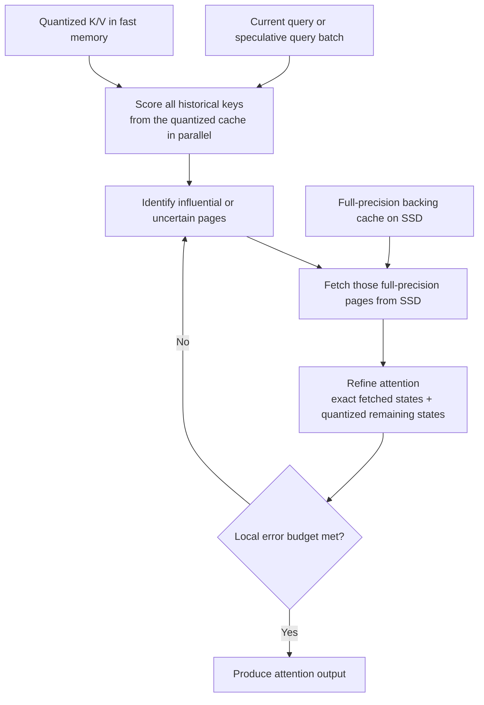
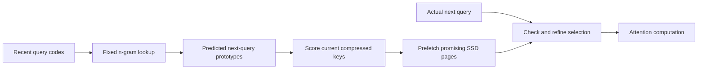
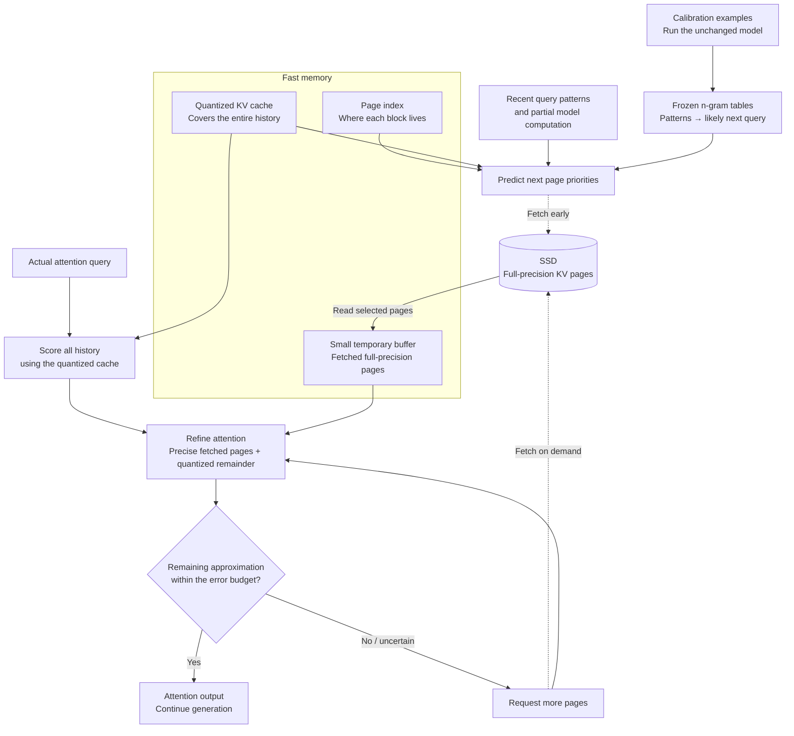

# KV-Cache Compression and Predictive SSD Paging: Verbatim Discussion

Date: 30 September 2026

This is a discussion archive, separate from the OnlySkills manual or an implementation specification. It preserves the available user utterances, spoken transcript excerpts, and backend assistant responses verbatim. Research claims, corrections, qualifications, and estimates remain as stated in the conversation; this archive does not newly verify them.

## How to read this record

- The spoken excerpts are the speech-to-text strings supplied during the voice conversation, not a fresh transcription verified against audio.
- The received utterance and spoken excerpt can overlap. Overlapping excerpts and repeated words are retained so no wording is silently discarded.
- Written backend responses can differ from the frontend assistant's spoken wording. Both are preserved and explicitly labeled; neither is presented as the other.
- Platform channel markers are preserved in the written responses. Tool calls, tool outputs, internal reasoning, system instructions, and unrelated project history are excluded.
- Original Markdown tables and Mermaid diagram sources are preserved. A plain ASCII rendering of the final architecture follows the chronological record.

## Chronological conversation record

### Voice handoff 1

**Received user utterance — verbatim**

~~~~text
Yeah... Brother, can you look into... the... uh unsloth dynamic quant method, the Sherry quantization method, the Bonsai method... and Tim Dettmers' also... yeah, like forget the Tim Dettmers one
~~~~

**Recorded spoken exchange — verbatim**

~~~~text
user:  Hey, everybody. Whatsup
assistant:  Hey! I’m ChatGPT. We can talk through ideas, work with what’s on your screen, and help research, write, code, or use connected tools. What do you want to tackle?
user:  Yeah... Brother, can you look into... the... uh unsloth dynamic quant method, the Sherry quantization method, the Bonsai method... and Tim Dettmers' also... yeah, like forget the Tim Dettmers one
~~~~

### Written assistant response 1

[STATUS] You’ve narrowed this to Unsloth dynamic quantization, Sherry, and Bonsai. The latter two names need source verification before I can compare their methods reliably.

### Voice handoff 2

**Received user utterance — verbatim**

~~~~text
? So
~~~~

**Recorded spoken exchange — verbatim**

~~~~text
user:  but the Bonzai, Sherry quantization, basically the stuff which Tencent released recently. And uh... uh Unsloth dynamic quant stuff, right? So
assistant:  Mm.
user: ? So
~~~~

### Written assistant response 2

[STATUS] Sherry is the Tencent-linked paper you mean. It combines ternary weights with structured sparsity; Unsloth instead varies precision across a model’s layers. Bonsai has both binary and ternary versions, so those need to be distinguished.

### Voice handoff 3

**Received user utterance — verbatim**

~~~~text
into those, yeah
~~~~

**Recorded spoken exchange — verbatim**

~~~~text
assistant:  Got it, I’ll focus on those.
user:  Yeah... Brother, can you look into... the... uh unsloth dynamic quant method, the Sherry quantization method, the Bonsai method... and Tim Dettmers' also... yeah, like forget the Tim Dettmers one but the Bonzai, Sherry quantization, basically the stuff which Tencent released recently. And uh... uh Unsloth dynamic quant stuff, right? So
user:  can you look into these methods? Yeah, yeah, please, please look into those, yeah
user: into those, yeah
~~~~

### Written assistant response 3

[STATUS] The sources show different routes to compression: Unsloth protects sensitive layers, while Sherry trains sparse ternary weights. PrismML also released a newer Bonsai generation this month, so I’m checking what changed before comparing it.

### Written assistant response 4

[STATUS] Two details change the comparison. Sherry’s 1.25-bit encoding forces exactly one zero in every four weights. Bonsai’s latest whitepaper describes rotated weights and a small amount of higher-precision storage, qualifying its announcement’s “end-to-end” wording.

### Voice handoff 4

**Received user utterance — verbatim**

~~~~text
yeah. And there is ternary quantization as well, right
~~~~

**Recorded spoken exchange — verbatim**

~~~~text
assistant:  Let me pin those down precisely.
user:  can you look into these methods? Yeah, yeah, please, please look into those, yeah
assistant:  I’m checking what changed in the newest Bonsai release, so the comparison’s accurate.
user:  Mm
assistant:  Two details matter here. Sherry forces a fixed pattern of zeros, and Bonsai’s latest paper qualifies that “end-to-end” claim with rotated weights and a small higher-precision component.
user:  yeah. And there is ternary quantization as well, right
~~~~

### Written assistant response 5

[STATUS] Yes—ternary is central here. Both Sherry and Ternary Bonsai use negative, zero, and positive weight values. Sherry adds a fixed sparsity pattern; Bonsai also offers a separate binary version.

### Written assistant response 6

::codex-realtime-inline{}
**Ternary quantization is a representation; Sherry and Bonsai are methods that use it.** Unsloth’s dynamic quantization chooses different precision levels across the model.

| Approach | Mechanism | What makes it distinct |
|---|---|---|
| **Unsloth Dynamic 3.0** | Calibrates an existing model and assigns quantization formats by layer/tensor sensitivity. | Post-training quantization: Unsloth explicitly says it uses neither quantization-aware training nor distillation. Version 3 improves calibration data and layer selection. [Official documentation](https://unsloth.ai/docs/basics/dynamic-3.0-ggufs) |
| **Tencent Sherry** | Uses ternary weights with **exactly three nonzero weights and one zero per four-weight block**. | Four possible zero positions × eight sign combinations = 32 patterns, fitting in **five bits per four weights: 1.25 bits/weight**, before scales and other overhead. Uses quantization-aware training and a temporary full-precision residual that decays away. [Paper](https://arxiv.org/html/2601.07892) |
| **PrismML Bonsai** | Original binary models store one sign bit per weight plus a shared scale; ternary variants add zero. | Binary g128 costs **1.125 bits/weight including scales**. The latest **Ternary Bonsai 2** uses a Hadamard-rotated basis, custom runtime kernels, and a small higher-precision component. Its compact language-model package is **5.93 GB, about 1.76 bits/weight**; vision is additional. [Binary model card](https://huggingface.co/prism-ml/Bonsai-8B-gguf), [Bonsai 2 whitepaper](https://github.com/PrismML-Eng/Bonsai-demo/blob/main/bonsai-2-27b-whitepaper.pdf) |

**Why ternary is called “1.58-bit”:** three unconstrained states carry `log₂(3) ≈ 1.585` bits of information. Actual storage also depends on packing, scales, and tensors kept at higher precision. Sherry gets below that rate by restricting which four-weight patterns are allowed.

**The evidence limits matter:**

- Sherry’s inspected experiments use Llama 3.2 at 1B and 3B, with **10 billion tokens of quantization-aware training**. Matching a ternary baseline does not mean matching full precision. [Experimental setup and results](https://arxiv.org/html/2601.07892)
- Bonsai’s inspected whitepapers disclose storage and inference details, but do not provide a reproducible conversion/training recipe. The original paper describes proprietary intellectual property. [Original whitepaper](https://github.com/PrismML-Eng/Bonsai-demo/blob/main/1-bit-bonsai-8b-whitepaper.pdf)
- Unsloth itself reports severe tool-use degradation for its smallest Qwen3.8 quants. Token agreement with full precision is different from successful agent execution. [Evaluation discussion](https://unsloth.ai/docs/basics/dynamic-3.0-ggufs)

These sources establish the mechanisms, but do **not** establish a winner across all three on the same model, hardware, and workload.

### Written assistant response 7

[COMPLETE] Yes. Ternary means each weight can be negative, zero, or positive, multiplied by a scale. Sherry and Ternary Bonsai both use that representation. Sherry restricts the zero pattern to make storage and execution efficient; the latest Bonsai also rotates the weight basis. Unsloth takes a different route: it calibrates an existing model and allocates precision according to sensitivity. I’ve put the sourced comparison on screen; these findings come from documentation and papers, not benchmarks I ran.

<oai-mem-citation>
<citation_entries>
MEMORY.md:946-956|note=[prior dynamic quant context checked before live source research]
</citation_entries>
<rollout_ids>
01a05271-86b2-7322-aa9b-a374eb6491b7
</rollout_ids>
</oai-mem-citation>

### Voice handoff 5

**Received user utterance — verbatim**

~~~~text
Yeah. Yeah, basically my main question was... so, uh... The best kind of compression that these systems achieve is those two that they-they're able to reduce the size by uh some five times or something, right? Like in the best case scenario
~~~~

**Recorded spoken exchange — verbatim**

~~~~text
assistant:  Yeah. Let me line that up precisely across these methods.
user:  yeah. And there is ternary quantization as well, right
assistant:  Yes, ternary is central here. Sherry and Ternary Bonsai both use negative, zero, and positive weight values; Sherry adds a fixed sparsity pattern, and Bonsai also has a binary variant. What’s distinct is how they use it but the tradeoff is overhead, not the idea of ternary itself. In practice, ternary means weights can be negative, zero, or positive, times a scale. Sherry and ternary Bonsai both use that, while Sherry constrains where the zeros can go for packing efficiency. Bonsai also rotates the weight basis, and Unsloth instead allocates precision by sensitivity. I’ve put the sourced comparison on screen.
user:  Yeah. Yeah, basically my main question was... so, uh... The best kind of compression that these systems achieve is those two that they-they're able to reduce the size by uh some five times or something, right? Like in the best case scenario
~~~~

### Written assistant response 8

[STATUS] The comparison depends on the starting precision. Against 16-bit weights, the verified Bonsai examples exceed fivefold compression.

### Written assistant response 9

::codex-realtime-inline{}
**Fivefold is not the upper limit—when starting from 16-bit weights.**

| Representation | Approximate weight compression versus 16-bit |
|---|---:|
| Uniform 4-bit | **4×**, before overhead |
| Ternary Bonsai 2, shipped compact format | **9.1×** |
| Binary Bonsai, including group scales | **14.2×** |
| Sherry’s encoded sparse weights | **12.8×**, before scales and other overhead |

Sources: [Bonsai 2 whitepaper](https://github.com/PrismML-Eng/Bonsai-demo/blob/main/bonsai-2-27b-whitepaper.pdf), [binary Bonsai format](https://huggingface.co/prism-ml/Bonsai-8B-gguf), [Sherry paper](https://arxiv.org/html/2601.07892).

These are **weight-storage ratios**. Total runtime memory includes activations, cache, and other components. Compression at a required capability level is a separate comparison.

### Written assistant response 10

[COMPLETE] They can go considerably beyond five times. Starting from 16-bit weights, ternary Bonsai achieves about ninefold compression, and binary Bonsai about fourteenfold, including its scales.

But if you’re starting from an already compressed 4-bit model, the additional reduction is only roughly two to three-and-a-half times. And those are weight-size reductions—total running memory shrinks less. The useful ceiling also depends on how much capability loss you’ll accept.

### Voice handoff 6

**Received user utterance — verbatim**

~~~~text
No, I-I-I meant in terms of, I meant in terms of uh... size
~~~~

**Recorded spoken exchange — verbatim**

~~~~text
assistant:  Mm-hmm, okay, let’s pin that down carefully.
user:  Yeah. Yeah, basically my main question was... so, uh... The best kind of compression that these systems achieve is those two that they-they're able to reduce the size by uh some five times or something, right? Like in the best case scenario
assistant:  It depends on what you’re comparing against; from sixteen-bit weights, the verified Bonsai examples are well beyond five times. So, they can go considerably beyond five times; from sixteen-bit weights, ternary Bonsai is about nine times, binary Bonsai about fourteen times, including scales. But versus four-bit,
user:  No, I-I-I meant in terms of, I meant in terms of uh... size
~~~~

### Written assistant response 11

[STATUS] Those ratios refer to the model’s stored size in gigabytes.

### Written assistant response 12

[COMPLETE] Yes—actual size. For example, Bonsai compresses an 8-billion-parameter model from about 16.4 GB to 1.15 GB: roughly fourteen times smaller.

It still has 8 billion parameters; each parameter takes fewer bits to store. If you mean reducing the parameter count itself, these methods generally don’t do that.

### Voice handoff 7

**Received user utterance — verbatim**

~~~~text
No, I meant the latest one. The-the one that uh Bonsai claimed as uh Bonsai claimed that it does brilliantly on Qwen three point eight twenty seven B
~~~~

**Recorded spoken exchange — verbatim**

~~~~text
assistant:  Right, size. Let me check that directly.
user:  No, I-I-I meant in terms of, I meant in terms of uh... size
user:  Yeah
assistant:  Those are actual size numbers. For example, one Bonsai eight-billion model goes from about sixteen point four gigabytes to one point one five, around fourteen times smaller. The parameter count stays the same; the storage per weight is what drops.
user:  No, I meant the latest one. The-the one that uh Bonsai claimed as uh Bonsai claimed that it does brilliantly on Qwen three point eight twenty seven B
~~~~

### Written assistant response 13

[STATUS] You mean Ternary Bonsai 2 27B, based on Qwen 3.8. Its compact release and Apple package have different sizes.

### Written assistant response 14

::codex-realtime-inline{}
**Latest model: Ternary Bonsai 2 27B, based on Qwen3.8-27B**

| Package | Stored size |
|---|---:|
| Full-precision language model | **53.8 GB** |
| Compact Bonsai language model | **5.93 GB — 9.1× smaller** |
| Bonsai Apple MLX package, including vision | **8.49 GB** |

The MLX package uses a less compact packing format and includes the full-precision vision tower.

PrismML reports **98.2% retention of its aggregate benchmark score**; that is its reported evaluation, not identical behavior on every task. [Whitepaper, sections 2.3 and 4](https://github.com/PrismML-Eng/Bonsai-demo/blob/main/bonsai-2-27b-whitepaper.pdf).

### Written assistant response 15

[COMPLETE] Right—I used the older model as the example. For the latest Bonsai 2 27B, the headline is about 54 GB down to 5.9 GB: roughly nine times smaller.

The Apple package is larger, at 8.49 GB including vision, so that version is closer to sixfold compression. Its claimed strong performance is 98.2% retention of the aggregate benchmark score.

### Voice handoff 8

**Received user utterance — verbatim**

~~~~text
uh fifty four... Fifty four- fifty four you're saying uh thirty two bit weight, right
~~~~

**Recorded spoken exchange — verbatim**

~~~~text
assistant:  Got it. Let me check that specific claim.
user:  No, I meant the latest one. The-the one that uh Bonsai claimed as uh Bonsai claimed that it does brilliantly on Qwen three point eight twenty seven B
assistant:  You’re talking about Ternary Bonsai 2, twenty-seven B on Qwen three point eight; the compact release and Apple package are different sizes. The latest numbers are about fifty-three point eight gigabytes down to five point nine three for the compact language model, roughly nine times smaller. The Apple package is eight point four nine including vision. Their “brilliantly” maps to ninety-eight point two percent aggregate benchmark retention.
user:  Sorry, can you- can you repeat that part
assistant:  Sure. The latest Bonsai twenty-seven B is about fifty-four gigs down to five point nine gigs; nine times smaller. The Apple package is eight point four nine, including vision
user:  uh fifty four... Fifty four- fifty four you're saying uh thirty two bit weight, right
~~~~

### Written assistant response 16

[STATUS] The 54 GB baseline uses sixteen-bit weights.

### Written assistant response 17

[COMPLETE] No—sixteen-bit. Each weight takes two bytes, so 27 billion weights take about 54 GB. At thirty-two bits, they’d take about 108 GB.

### Voice handoff 9

**Received user utterance — verbatim**

~~~~text
Mm. Okay, okay Yeah, so basically what I was primarily... Thinking about this... is that... if this works so nicely... for weights... Okay... then... In these quantization schemes... do they also apply these for longer text
~~~~

**Recorded spoken exchange — verbatim**

~~~~text
assistant:  Let me check that detail.
user:  uh fifty four... Fifty four- fifty four you're saying uh thirty two bit weight, right
assistant:  No, sixteen-bit. Two bytes per weight makes about fifty-four gigs; thirty-two-bit would be about
user:  Oh. So around ten times smaller
assistant:  Yeah, roughly nine times, close to ten.
user:  Mm. Okay, okay Yeah, so basically what I was primarily... Thinking about this... is that... if this works so nicely... for weights... Okay... then... In these quantization schemes... do they also apply these for longer text
~~~~

### Written assistant response 18

[STATUS] Weight compression reduces the model’s fixed size. Longer context also uses a growing memory cache, which can be compressed separately.

### Written assistant response 19

::codex-realtime-inline{}
**Yes—long-context memory can also be quantized, through a separate mechanism.**

| What gets compressed | What it saves |
|---|---|
| **Model weights** | The model’s fixed memory footprint |
| **KV cache** | Memory for stored attention states, which grows with context in full-attention layers |

KV-cache quantization stores those states at lower precision. For example, 16-bit → 4-bit gives an ideal **4× reduction in the quantized payload**, before overhead. It does **not** reduce the number of text tokens. [Cache quantization documentation](https://huggingface.co/docs/transformers/en/kv_cache#quantized-cache)

For **Bonsai 2**, the whitepaper lists **sub-4-bit KV compression as early results under “Limitations and Roadmap.”** That is separate from its released ternary weight compression. [Whitepaper, section 5](https://github.com/PrismML-Eng/Bonsai-demo/blob/main/bonsai-2-27b-whitepaper.pdf)

### Written assistant response 20

[COMPLETE] Yes—if you mean reducing the memory needed for long text, the same general idea applies.

The model stores numerical states for the text it has processed, called the key-value cache. Those can also be quantized to use fewer bytes per token. But compressing weights doesn’t automatically compress that cache.

For the latest Bonsai, its paper describes very low-bit cache compression as early work on the roadmap, separate from the released weight compression.

### Voice handoff 10

**Received user utterance — verbatim**

~~~~text
uh same techniques as Bonsai, like I'm talking the core techniques, core compression techniques of Bonsai, Ternary, Sherry quantization, Unsloth... like all these cases, right? And I'm- has anyone used it... specifically to... uh... lower down the context size. Or just try to look into... if we have such crazy KV cache compression... algorithms... which uh... which also have something like five times, ten times compression kind of thing. Yeah
~~~~

**Recorded spoken exchange — verbatim**

~~~~text
assistant:  Let me pin that down.
user:  Mm. Okay, okay Yeah, so basically what I was primarily... Thinking about this... is that... if this works so nicely... for weights... Okay... then... In these quantization schemes... do they also apply these for longer text
assistant:  Weight compression shrinks the model’s fixed size; longer context also uses a growing memory cache, which is a separate target.
user:  Yeah, so what I'm trying to ask here is is that has anyone uh used uh same techniques as Bonsai, like I'm talking the core techniques, core compression techniques of Bonsai, Ternary, Sherry quantization, Unsloth... like all these cases, right? And I'm- has anyone used it... specifically to... uh... lower down the context size. Or just try to look into... if we have such crazy KV cache compression... algorithms... which uh... which also have something like five times, ten times compression kind of thing. Yeah
user: uh same techniques as Bonsai, like I'm talking the core techniques, core compression techniques of Bonsai, Ternary, Sherry quantization, Unsloth... like all these cases, right? And I'm- has anyone used it... specifically to... uh... lower down the context size. Or just try to look into... if we have such crazy KV cache compression... algorithms... which uh... which also have something like five times, ten times compression kind of thing. Yeah
~~~~

### Written assistant response 21

[STATUS] That narrows the question to methods that compress the context cache by five to ten times, and whether they reuse the ideas behind those weight quantizers.

### Written assistant response 22

[STATUS] Yes—published cache methods reach the range you’re asking about, including two-bit quantization and rotation-based approaches. I also found an experimental Bonsai cache option at roughly three-and-a-half times compression; my earlier answer covered only its whitepaper roadmap.

### Voice handoff 11

**Received user utterance — verbatim**

~~~~text
So when you say... this work exists, can you share the link for these works
~~~~

**Recorded spoken exchange — verbatim**

~~~~text
assistant:  Right, let me check that carefully.
user:  Yeah, so what I'm trying to ask here is is that has anyone uh used uh same techniques as Bonsai, like I'm talking the core techniques, core compression techniques of Bonsai, Ternary, Sherry quantization, Unsloth... like all these cases, right? And I'm- has anyone used it... specifically to... uh... lower down the context size. Or just try to look into... if we have such crazy KV cache compression... algorithms... which uh... which also have something like five times, ten times compression kind of thing. Yeah
user:  Mm
assistant:  I’m seeing published cache work in that range, plus an experimental Bonsai cache option around three and a half times. My earlier answer only covered their roadmap.
user:  So when you say... this work exists, can you share the link for these works
~~~~

### Written assistant response 23

[STATUS] RotateKV and OSCAR are the closest matches to the rotation idea you asked about. Their reported cache formats give roughly sevenfold compression against sixteen-bit storage.

### Written assistant response 24

::codex-realtime-inline{}
Yes—here are the primary sources. **Ratios below concern KV-cache storage, compared with 16-bit storage.**

| Work | Core idea | Compression evidence |
|---|---|---|
| **[OSCAR — paper and code](https://github.com/FutureMLS-Lab/OSCAR)** | Fits attention-aware rotations, then quantizes to two bits. | Reports **2.28 effective bits per cache element**, equivalent to about **7×** compression. |
| **[RotateKV — paper](https://arxiv.org/abs/2501.16383)** | Uses outlier-aware Hadamard rotations and protects important attention states. | Reports **2.25 average bits**, equivalent to about **7.1×** compression. |
| **[KVQuant — paper](https://arxiv.org/abs/2401.18079)** | Uses calibrated nonuniform quantization and stores outliers separately. | One reported three-bit configuration reduces cache size from **64 GB to 13.3 GB: 4.8×**. |
| **[TurboQuant — paper](https://arxiv.org/abs/2504.19874)** · **[Google’s explanation](https://research.google/blog/turboquant-redefining-ai-efficiency-with-extreme-compression/)** | Combines random rotation, low-bit quantization, and a residual correction sketch. | Google reports **at least 6×** cache reduction in its retrieval experiments; results depend on configuration. |
| **[Coupled Quantization — “KV Cache is 1 Bit Per Channel”](https://arxiv.org/abs/2405.03917)** | Jointly encodes correlated channels using learned vector codebooks. | Explores **one-bit-per-channel codes**, nominally **16×** smaller. Codebook overhead and substantial quality loss in some configurations qualify that headline. |

For Bonsai specifically: **[experimental four-bit KV-cache support](https://github.com/PrismML-Eng/Bonsai-demo/blob/main/KV-CACHE.md)** documents about **3.5×** cache compression.

**The connection is real:** rotations, calibration, and protecting sensitive values appear in cache compression too. These are adaptations for attention states; the sources do not establish direct reuse of Bonsai’s proprietary recipe or Sherry’s exact sparse-ternary training method.

### Voice handoff 12

**Received user utterance — verbatim**

~~~~text
Yeah, basically I'm trying to find the... best option to read or uh use, from its implementation, like even if the implementation is present in the form of a... a block diagram architecture. uh And the results are crazy. And also look- look, trust worthy. in- in terms of like the kind of uh data they have chosen to evaluate on, the complexity of the tasks they've gone gone for, the diversity, and how basically things which are actually adversarial to uh such plays, right? Not just uh convenient choices... for these. So, can you find those
~~~~

**Recorded spoken exchange — verbatim**

~~~~text
assistant:  Let me pull those together.
user:  So when you say... this work exists, can you share the link for these works
assistant:  Yes—links are on screen. For rotation-based cache compression, RotateKV
assistant:  reach about seven times. Calibration and outlier handling get around five to six, and there’s experimental Bonsai cache around three-point-five times. These ideas show up there, but that’s not the same as reusing Bonsai or Sherry directly. If you want, I can narrow it to open-source options or to quality at long context.
user:  Yeah, basically I'm trying to find the... best option to read or uh use, from its implementation, like even if the implementation is present in the form of a... a block diagram architecture. uh And the results are crazy. And also look- look, trust worthy. in- in terms of like the kind of uh data they have chosen to evaluate on, the complexity of the tasks they've gone gone for, the diversity, and how basically things which are actually adversarial to uh such plays, right? Not just uh convenient choices... for these. So, can you find those
~~~~

### Written assistant response 25

[STATUS] OSCAR’s reported evidence includes repeated reasoning and coding tests with long outputs. To judge it against your criteria, the key questions are calibration overlap, baseline fairness, difficult retrieval tests, and whether the compression figure includes all cache overhead.

### Written assistant response 26

[STATUS] OSCAR’s longest-context test exposes a substantial loss: on its eight-billion-parameter Qwen model, retrieval accuracy falls from about 78% to 45% at 128,000 tokens. Its reasoning results are promising, but that makes it a conditional candidate for your use case.

### Voice handoff 13

**Received user utterance — verbatim**

~~~~text
And
~~~~

**Recorded spoken exchange — verbatim**

~~~~text
assistant:  Let me check that carefully.
user:  Yeah, basically I'm trying to find the... best option to read or uh use, from its implementation, like even if the implementation is present in the form of a... a block diagram architecture. uh And the results are crazy. And also look- look, trust worthy. in- in terms of like the kind of uh data they have chosen to evaluate on, the complexity of the tasks they've gone gone for, the diversity, and how basically things which are actually adversarial to uh such plays, right? Not just uh convenient choices... for these. So, can you find those
assistant:  I’m seeing some long-output evidence, but benchmarking details need careful scrutiny. Let me sort that out.
user:  Mm
assistant:  OSCAR’s longest-context test shows a big drop, so it’s promising but not a clear best option.
user:  And
~~~~

### Written assistant response 27

[STATUS] There’s also a calibration concern with OSCAR: one section says it uses MMLU-style data, while another calls GPQA-Diamond the default, and the code supports calibrating on GPQA prompts. That needs resolution before treating its GPQA result as a clean held-out test.

### Written assistant response 28

[STATUS] KVarN looks like the strongest first read so far: it tests error accumulation during generation, exact retrieval, and executed code, and requires no calibration dataset. Its aggressive research setting is about sevenfold cache compression; the released serving configuration uses more bits and reports roughly three-to-fivefold extra cache capacity.

### Written assistant response 29

[STATUS] A broader candidate changes the reading shortlist: NVIDIA’s KVTC reports around twentyfold storage compression and tests variable tracking, multi-hop questions, and competition reasoning. Its important boundary is that it decompresses the cache for generation; KVarN targets the active decoding cache.

### Written assistant response 30

::codex-realtime-inline{}
**My shortlist is KVTC for the strongest compression idea to study, and KVarN for an active-cache implementation to try.** This is my judgment from the papers, evaluation details, and selected source code; I have not reproduced their results.

| Candidate | Why it fits your criteria | Important boundary |
|---|---|---|
| **[KVTC — paper](https://arxiv.org/html/2511.01815)** | Around **20× storage compression**, with unusually broad evaluation and calibration ablations. | Cache is **decompressed for generation**. |
| **[KVarN — paper](https://arxiv.org/html/2606.03458)** · **[official implementation](https://github.com/huawei-csl/KVarN)** | Tests generation-time error accumulation; calibration-free; runnable serving integration. | Research setting is about **7×**; released configuration reports **3–5× cache capacity**. |
| **[PM-KVQ — published paper](https://proceedings.iclr.cc/paper_files/paper/2026/file/afb8caec018d3c8f6ef8b81fa52386fe-Paper-Conference.pdf)** · **[code](https://github.com/thu-nics/PM-KVQ)** | Strong stress tests for long reasoning across multiple model sizes. | Main quality experiments simulate quantization; bit-width changes during generation. |

**Read KVTC first for the architecture and evaluation breadth.** It combines PCA decorrelation, adaptive bit allocation, and entropy coding:

Its evaluation includes AIME, LiveCodeBench, scientific-document QA, multi-hop QA, “lost in the middle” retrieval, and variable tracking—not merely single-needle lookup. It also tests calibration-domain shifts and reports standard errors. Two qualifications matter: headline ratios exclude protected recent/sink tokens, and calibration uses FineWeb plus OpenR1-Math; I have not independently audited benchmark overlap. **Start with Figures 1 and 5, Section 4, and Appendices B.6, B.12–B.15.** [KVTC methods and evidence](https://arxiv.org/html/2511.01815)

**Read KVarN next for the failure mechanism and practical path.** Its central observation is that token-magnitude errors compound during autoregressive generation. Rotation alone does not fix that; it adds variance normalization. It evaluates competition math, executed code, instruction following, and exact retrieval of random codes, with repeated runs. However, its two-bit research results still show losses—for example, Qwen3-4B MATH-500 drops from **82.6% to 79.2%**. Its paper does not establish reliable retrieval at 128K. [Paper, Sections 3–4 and Appendix D](https://arxiv.org/html/2606.03458)

The released implementation deliberately uses **four-bit keys and two-bit values**, a more conservative setting than the paper’s two-bit-both experiment. That distinction makes its practical compression claim easier to interpret. [Implementation and architecture](https://github.com/huawei-csl/KVarN)

**PM-KVQ is the useful third read.** It tests AIME 2024/2025, another math competition, and competition coding with outputs allowed to reach 32K tokens. Calibration comes from RedPajama academic papers, and evaluation spans reasoning models from 7B to 70B. It explains why short calibration and immediate low-bit conversion can fail. Its quality evidence is valuable, but simulated quantization does not itself prove the memory footprint of a deployed system. [Published paper](https://proceedings.iclr.cc/paper_files/paper/2026/file/afb8caec018d3c8f6ef8b81fa52386fe-Paper-Conference.pdf)

**I would put OSCAR behind these for your trust criterion.** Its paper has conflicting calibration descriptions, its default code calibrates on GPQA prompts, and its eight-billion-parameter model loses substantial retrieval accuracy at 128K. That merits investigation rather than dismissal. [Paper](https://arxiv.org/html/2605.17757), [calibration source](https://github.com/FutureMLS-Lab/OSCAR/blob/main/rotation/_eval_runner/dump_gpqa_prompts.py)

Among these inspected works, **none establishes tenfold active-cache compression with preserved quality across long documents, difficult reasoning, coding, and adversarial multi-turn use**.

### Written assistant response 31

[COMPLETE] I’d read KVTC first for the strongest combination of ambitious compression and broad stress tests. It reports around twentyfold compression, but for cache storage between inference phases.

For something to try during generation, I’d start with KVarN. Its practical release is more conservative—roughly three-to-fivefold extra cache capacity—and its evaluation explicitly examines accumulating errors.

The comparison and reading links are on screen, including the limitations that kept OSCAR from being my first pick.

### Voice handoff 14

**Received user utterance — verbatim**

~~~~text
Uh what is wrong with using the same technique that we have... for this
~~~~

**Recorded spoken exchange — verbatim**

~~~~text
assistant:  Let me line up the rest against your criteria.
user:  And
assistant:  There’s also a calibration concern with OSCAR; the GPQA setup is inconsistent, so that result needs caution.
assistant:  So far, KVarN looks strongest for your criteria: it tests generation error and exact retrieval, without calibration data, but the shipped config reports a smaller gain than seven times.
user:  Uh what is wrong with using the same technique that we have... for this
~~~~

### Written assistant response 32

[STATUS] The core ideas do transfer—KVarN and RotateKV reuse rotation-based quantization. The difficulty is preserving attention behavior as the cache changes with every input and generated token.

### Written assistant response 33

[COMPLETE] Nothing is fundamentally wrong with reusing the core ideas. People already do. The challenge is adapting what the compression preserves.

Weights are fixed, so you can calibrate their quantization offline—and, in methods such as Sherry, train the model to tolerate it. Cache values change with each prompt and generated token.

For the cache, small numerical errors can change which earlier information receives attention. That changes the next token, which changes later cache entries, so errors can accumulate during generation.

For example, applying Sherry’s “one zero in every four values” directly to cached states could remove a distinction needed for exact retrieval. You’d need to validate that pattern or train the model to tolerate it.

So the useful research question is: **can we adapt the rotation, scaling, sparsity, and bit allocation to preserve attention decisions?** That’s exactly where these cache methods differ.

### Voice handoff 15

**Received user utterance — verbatim**

~~~~text
Wait, wait, wait, wait. So... uh... rates are one thing. Okay. but the KV cache population and all... is happening via attention, right? And uh and we also quantize attention heads and stuff in these methods. Right? So, even the attention rates and all those things. do- do we- do we, like uh do we not touch the attention rates for quantization or attention embeddigs... for quantization or whatever we call this KV cache thing
~~~~

**Recorded spoken exchange — verbatim**

~~~~text
assistant:  One sec, let me line that up precisely. What’s most promising is KVTC
user:  Uh what is wrong with using the same technique that we have... for this
user:  Mm
assistant: ’s compression idea; it reports around twenty times and tests variable tracking, multi-hop, and AIME, but it decompresses for generation. For implemented use, I’d start with KVarN; its deployed setting is more conservative, about three-to-five times, and it checks accumulating errors. The shortlist and links are on screen.
assistant:  The ideas do transfer; the challenge is preserving attention behavior as the cache evolves with every token.
assistant:  Nothing is fundamentally wrong with reusing the core ideas, and people already do; the hard part is what the compression preserves. Weights are fixed, so you can calibrate or train for that. Cache values change token by token, and small numeric errors can shift attention, which cascades. So the question becomes whether rotation
user:  Yeah, I don't know, wait, wait, wait
assistant:  Mm-hmm. Go ahead.
user:  Wait, wait, wait, wait. So... uh... rates are one thing. Okay. but the KV cache population and all... is happening via attention, right? And uh and we also quantize attention heads and stuff in these methods. Right? So, even the attention rates and all those things. do- do we- do we, like uh do we not touch the attention rates for quantization or attention embeddigs... for quantization or whatever we call this KV cache thing
~~~~

### Written assistant response 34

[STATUS] Yes—the attention projection weights are quantized too. Their computed key and value outputs can still be stored at sixteen-bit precision; weight precision and cache precision are separate choices.

### Written assistant response 35

::codex-realtime-inline{}
**Quantizing attention’s learned matrices does not automatically quantize their outputs.**

| Quantity | What it is |
|---|---|
| **Attention projection weights** | Learned matrices that produce queries, keys, and values |
| **KV cache** | Computed key/value vectors for previous tokens |
| **Attention scores** | Input-dependent relevance scores computed from queries and keys |

Bonsai 2’s whitepaper explicitly says its activations remain at higher precision. Compressing the cache adds another quantization step to the computed K/V vectors. [Bonsai whitepaper, Appendix A](https://github.com/PrismML-Eng/Bonsai-demo/blob/main/bonsai-2-27b-whitepaper.pdf), [KV-cache quantization](https://huggingface.co/docs/transformers/en/kv_cache#quantized-cache).

### Written assistant response 36

[COMPLETE] Yes—we do quantize the learned weights inside attention. My earlier explanation skipped the next step.

Those compressed weights produce key and value vectors, which can still be sixteen-bit numbers. The cache stores those output vectors, not the compressed weights that produced them.

So Bonsai can have ternary attention weights while retaining a sixteen-bit KV cache. Quantizing the cache means rounding those computed vectors again. That’s an additional source of error, which needs its own evaluation.

### Voice handoff 16

**Received user utterance — verbatim**

~~~~text
If we offload it to SSD
~~~~

**Recorded spoken exchange — verbatim**

~~~~text
assistant:  Let me check that carefully.
user:  Wait, wait, wait, wait. So... uh... rates are one thing. Okay. but the KV cache population and all... is happening via attention, right? And uh and we also quantize attention heads and stuff in these methods. Right? So, even the attention rates and all those things. do- do we- do we, like uh do we not touch the attention rates for quantization or attention embeddigs... for quantization or whatever we call this KV cache thing
assistant:  Yes, the attention projections are quantized too, but the computed keys and values can still be stored at sixteen

 
 bit. Those are separate choices. Right, we do quantize the learned weights inside attention. What I skipped is that the cache stores computed vectors, not the compressed weights. So Bonsai can keep ternary attention weights while the cache remains sixteen-bit- quantizing the cache means rounding those computed vectors again, which is an additional error source to evaluate.
user:  If we offload it to SSD
~~~~

### Written assistant response 37

[STATUS] SSD offloading can preserve the cache’s numerical precision and free memory. The tradeoff is retrieving that cache quickly enough during generation.

### Written assistant response 38

[COMPLETE] Yes—you can move the KV cache to SSD without quantizing it, preserving its values.

The difficulty is speed: standard full attention reads the previous keys and values for every new token. If those reads repeatedly reach the SSD, generation can become much slower.

SSD works especially well for parking an inactive conversation’s cache and restoring it when needed. That’s where KVTC’s compression helps: less storage and less data to transfer. Streaming an active cache from SSD is possible, but the repeated transfers become the bottleneck.

### Voice handoff 17

**Received user utterance — verbatim**

~~~~text
And... only- and only keep the quantized stuff in memory
~~~~

**Recorded spoken exchange — verbatim**

~~~~text
assistant:  Let me-
user:  If we offload it to SSD
user:  And... only- and only keep the quantized stuff in memory
~~~~

### Written assistant response 39

[STATUS] That gives you a two-tier cache: a compact quantized copy in fast memory, and a full-precision copy on SSD that you can fetch when needed.

### Voice handoff 18

**Received user utterance — verbatim**

~~~~text
- think about uh uh... then think about how- how would you read it for all tokens at once... think out of the box
~~~~

**Recorded spoken exchange — verbatim**

~~~~text
assistant:  SSD offloading preserves values and saves memory, but reading it back for every token can slow generation a lot. It’s great for parking inactive sessions; streaming live is the hard part.
user:  And... only- and only keep the quantized stuff in memory
user:  Then think about... then thi- think about uh uh... then think about how- how would you read it for all tokens at once... think out of the box
user: - think about uh uh... then think about how- how would you read it for all tokens at once... think out of the box
~~~~

### Written assistant response 40

[STATUS] The quantized copy lets you score all historical tokens in parallel without reading the SSD. A useful next step is to fetch full-precision pages only where those approximate scores could change the attention result, then reuse each fetched page across several queries.

### Written assistant response 41

::codex-realtime-inline{}
**A concrete design: keep a compressed global view in memory, and use SSD for selective precision recovery.**

The useful additions are:

- **Fetch by uncertainty as well as approximate rank.** Quantization can push an important token below the apparent top results. Bounds on score error help decide which pages need refinement.
- **Keep the remaining context’s contribution.** Use its quantized states rather than discarding everything outside the retrieved set.
- **Amortize SSD reads.** Speculative decoding supplies candidate tokens that can be verified as a batch. Each fetched history page can serve several queries before being evicted.
- **Coalesce and prefetch pages.** Contiguous reads and overlapping transfer with computation reduce small-read overhead.

For a complete full-precision scan, a second option is **streaming tiled attention**: read a history tile once, apply it to the entire query batch, update the running softmax/output accumulators, and move on. The entire cache need not fit in fast memory.

**Historical tokens can be processed in parallel. Future output tokens require their preceding outputs**, so speculative verification provides a practical route to batching them.

This is a proposed combination, not a demonstrated SSD implementation. [ParisKV](https://arxiv.org/abs/2602.07721) is a related published system: it uses compressed retrieval estimates and selectively fetches full-precision states from **CPU memory**. SSD performance and end-to-end quality would need separate validation. Local attention-error bounds also cannot undo earlier generation errors.

### Written assistant response 42

[COMPLETE] Yes—use the quantized cache as a fast global index. Score all past tokens together, then fetch full-precision SSD pages only where precision could change the result.

And batch the queries: speculative decoding lets you verify several candidate tokens together, so one fetched page can serve several tokens.

Even a full scan can stream one SSD tile at a time and compute attention for the whole batch. That saves memory and amortizes reads. The crucial challenge is catching important tokens that quantization makes look unimportant; uncertainty-based refinement helps address that.

### Voice handoff 19

**Received user utterance — verbatim**

~~~~text
And how hard is it to do
~~~~

**Recorded spoken exchange — verbatim**

~~~~text
assistant:  Let me think that through.
user:  Then think about... then thi- think about uh uh... then think about how- how would you read it for all tokens at once... think out of the box
user:  Mm
assistant:  The quantized copy is what lets you touch all tokens without hitting the SSD, then you pull only the full-precision pages likely to matter.
user:  Sorry, can you repeat
assistant:  Sure. The quantized copy is what lets you touch all tokens without hitting the SSD, then you pull only the full-precision pages likely to matter.
assistant:  Concretely, keep the quantized cache as a global sketch in memory, fetch full-precision pages where precision could change the result. And batch queries: speculative verification lets one fetch serve several tokens. Even a full scan can stream one SSD tile at a time for the whole batch.
user:  And how hard is it to do
~~~~

### Written assistant response 43

[STATUS] The basic prototype can reuse existing cache and retrieval components. The uncertain part is selective refinement: deciding what to fetch without missing important information. I’m using the capability-horizon estimator to separate that research risk from the implementation work.

### Written assistant response 44

::codex-realtime-inline{}
**A prototype is manageable. Proving that it preserves quality and beats an ordinary quantized cache is research work.**

Rough effort for an experienced inference engineer, reusing existing attention and cache code:

| Result | Planning estimate | What it establishes |
|---|---:|---|
| One-model correctness prototype | **2–5 working days** | Quantized cache in memory, full-precision backing copy, selective fetch and refinement |
| Credible quality/performance experiment | **2–6 weeks** | Real SSD transfers, difficult workloads, comparison with full precision and ordinary cache quantization |
| Reusable serving integration | **1–3 months** | Batching, cache updates, speculative verification, concurrency, prefetching, and fallback behavior |

These are engineering estimates anchored to substantial multi-file integration and repeated ML experiments. They exceed the estimator’s 16-hour benchmark range, so they are extrapolations—not measured completion times or guarantees of success.

**The make-or-break question:** can the compact cache identify a *small* set of pages that need full precision, including important pages whose approximate scores are misleading?

The first experiment should keep the backing copy in RAM, measure selection misses and answer quality, and record how many bytes would need fetching. Then move that same design to SSD. That isolates the algorithm’s accuracy from storage latency.

### Written assistant response 45

[COMPLETE] A one-model prototype is reasonably manageable—roughly a few engineering days if we reuse existing components.

The hard part is proving the speed-and-quality tradeoff. If the quantized view reliably selects only a few pages, SSD refinement could work well. If it misses important pages—or needs most of them—the benefit disappears.

I’d test page selection with the full-precision copy in RAM first. That quickly tells us whether the idea deserves the harder SSD integration. Credible evaluation would likely take weeks; those are planning estimates, not guarantees.

### Voice handoff 20

**Received user utterance — verbatim**

~~~~text
I didn't get it
~~~~

**Recorded spoken exchange — verbatim**

~~~~text
assistant:  Let me-
user:  And how hard is it to do
assistant:  The basic prototype is doable; the uncertainty is selective refinement.
user:  I didn't get it
~~~~

### Written assistant response 46

[STATUS] Keeping both copies is the easy part. Choosing which pieces to fetch from SSD is the hard part.

### Written assistant response 47

[COMPLETE] Think of it like a book: you keep a small, blurry copy in memory and the clear original on SSD.

You use the blurry copy to decide which pages to fetch. The difficulty is that it might hide an important page. Fetch too few pages, and answers can become wrong. Fetch too many, and it becomes slow.

Making this run could take a few days. Showing that it stays accurate *and* fast would take longer—probably weeks.

### Voice handoff 21

**Received user utterance — verbatim**

~~~~text
and gram... Can you- can you think of using... N-Gram like systems for this, but purely with calibration data
~~~~

**Recorded spoken exchange — verbatim**

~~~~text
assistant:  Let me put that plainly.
user:  I didn't get it
assistant:  Plainly: a prototype is manageable but proving it’s reliable and faster than a normal quantized cache is research work. A single-model prototype is a few days, but credible evaluation likely takes weeks. Test the selection logic in RAM first, then decide on SSD. Keeping both copies is the easy part. The hard part is selection. Think of a small, blurry book in memory and the clear original on SSD. You use the blurry one to choose pages.
user:  and gram... Can you- can you think of using... N-Gram like systems for this, but purely with calibration data
~~~~

### Written assistant response 48

[STATUS] A calibration-only n-gram system could predict which cache pages to fetch before they’re needed. The compressed cache could still cover the full history, so a missed prediction would trigger a fallback rather than erase that information.

### Written assistant response 49

::codex-realtime-inline{}
**Yes: use a fixed, calibration-built n-gram predictor to schedule SSD reads.** This is a proposed design, not a measured result.

The stronger version would use **n-grams of discretized query/attention states**, alongside token n-grams. The same words can attend to different passages in different contexts.

**Offline, using calibration data only:**

1. Run the unchanged model on representative prompts and generated continuations.
2. Cluster its query vectors into a small, fixed codebook, separately by layer/head.
3. Count transitions: “after query codes A → B → C, the next query usually resembles D.”
4. Use a separate calibration holdout to choose n-gram length, backoff rules, and confidence thresholds.

**At runtime:**

**Why predict query prototypes rather than page addresses?** Page addresses change with every conversation. A predicted query can be matched against the current conversation’s compressed keys.

The n-gram table controls **what arrives early**. The actual query still determines what is needed; missing pages can be fetched on demand. This separates prediction mistakes from the decision to discard information, although the underlying cache approximation still needs quality checks.

The codebook and transition tables stay frozen after calibration. Runtime cache indexing does not require further fitting or model fine-tuning.

Related published work: [InfiniGen](https://arxiv.org/abs/2406.19707) predicts needed KV entries through a partial attention rehearsal; [OasisKV](https://arxiv.org/abs/2608.08097) uses speculative lookahead for prefetching. These support the prefetch direction, but do not establish that this calibration-only n-gram variant works.

### Written assistant response 50

[COMPLETE] Yes. Build a lookup table from calibration runs: “when the last few attention queries look like this, the next usually looks like that.”

Use that prediction to fetch likely SSD pages early. When the real query arrives, check it and fetch anything missing.

I’d include patterns of attention states, rather than relying only on word sequences. Words alone can miss long-range dependencies.

The model stays unchanged, and the table is frozen after calibration. The predictor schedules reads; it doesn’t decide what information the model is allowed to remember.

### Voice handoff 22

**Received user utterance — verbatim**

~~~~text
Sorry
~~~~

**Recorded spoken exchange — verbatim**

~~~~text
assistant:  Let me think about that carefully.
user:  and gram... Can you- can you think of using... N-Gram like systems for this, but purely with calibration data
assistant:  A calibration-only n-gram system could prefetch likely pages, while the compressed cache still covers everything, so misses just fall back.
user:  Sorry
~~~~

### Written assistant response 51

[STATUS] The n-gram table would predict what to fetch early, using patterns measured in calibration runs.

### Written assistant response 52

[COMPLETE] We could use calibration data to build a table saying: “after this pattern, the model usually needs this kind of earlier information.”

During use, that table helps fetch likely pieces from SSD before they’re needed. If the guess is wrong, we fetch the missing pieces then.

The table stays fixed; there’s no model fine-tuning.

### Voice handoff 23

**Received user utterance — verbatim**

~~~~text
Yeah, basically we can use some sort of uh paging segmentation like operating system... kind of tricks... for this, right? where uh we already know lots of approximating frequentist algos uh slash learned algos that like just from data or just from the weights, because... the weights literally contain... the capability to predict... whatever is going to happen, all that shit, right... so... You should be capable of using this
~~~~

**Recorded spoken exchange — verbatim**

~~~~text
assistant:  Let me put it more plainly.
user:  Sorry
assistant:  Sure. Think a fixed n-gram predictor built offline from calibration data to prefetch likely pages. A better version uses n-grams of discretized attention states, not just words. The table is frozen and doesn’t decide what’s allowed, it just fetches early. So, in plain terms: from calibration runs, we build a table: ‘after this pattern, the model usually needs this kind of earlier information’. At runtime, that helps prefetch likely pieces from SSD, and if it guesses wrong- we fetch what’s missing then.
user:  Yeah, basically we can use some sort of uh paging segmentation like operating system... kind of tricks... for this, right? where uh we already know lots of approximating frequentist algos uh slash learned algos that like just from data or just from the weights, because... the weights literally contain... the capability to predict... whatever is going to happen, all that shit, right... so... You should be capable of using this
~~~~

### Written assistant response 53

[STATUS] There’s a concrete precedent for your weights-based idea: InfiniGen uses part of the next layer’s query weights and the current hidden state to anticipate which KV entries to prefetch. That fits naturally with paged storage.

### Written assistant response 54

::codex-realtime-inline{}
**Yes—OS paging techniques are a useful foundation for this design.**

| OS concept | KV-cache equivalent |
|---|---|
| Pages and address mapping | Token blocks grouped by layer/head, mapped to SSD locations |
| Compact resident representation | Quantized copy of the history in fast memory |
| Working-set prediction | Recency/frequency, calibration-built n-gram tables, and partial attention forecasts |
| Prefetch and read-ahead | Fetch predicted pages asynchronously; combine nearby reads |
| Demand access | Use the actual query to request additional full-precision pages when refinement is needed |

The **weights-based predictor has an existing precedent**: [InfiniGen](https://arxiv.org/abs/2406.19707) combines the current hidden state, partial next-layer query weights, and partial keys to forecast important KV entries. Its offloaded backing store is CPU memory; SSD would require a separate latency evaluation.

**One correction to my earlier explanation:** a wrong prediction does not automatically produce a page fault. The quantized copy is already available, so attention can proceed with an inaccurate approximation. A software check must decide when more precision is needed.

The weights provide a conditional forecasting mechanism **when combined with the current context**. They do not identify the future page accesses on their own.

A concrete implementation would keep only the quantized representation persistently in fast memory, with small temporary buffers for fetched full-precision pages. Prefetching schedules those reads; query-based refinement controls their necessity.

### Written assistant response 55

[COMPLETE] Yes—we can build on paging, frequency-based prediction, and the model’s own weights. InfiniGen already demonstrates partial attention forecasting for prefetching.

The key difference from an OS is that attention doesn’t request one definite address. It scores the history. And because a quantized copy exists, a mistaken prediction won’t automatically cause a page fault.

So we need two parts: a predictor that fetches pages early, and a check using the actual query that decides whether more precision is needed. That’s a concrete, implementable design.

### Voice handoff 24

**Received user utterance — verbatim**

~~~~text
Yeah. So, describe it to me in the same way you typically describe using in a diagram shit, right? Yeah
~~~~

**Recorded spoken exchange — verbatim**

~~~~text
assistant:  Let me think about that carefully.
user:  Yeah, basically we can use some sort of uh paging segmentation like operating system... kind of tricks... for this, right? where uh we already know lots of approximating frequentist algos uh slash learned algos that like just from data or just from the weights, because... the weights literally contain... the capability to predict... whatever is going to happen, all that shit, right... so... You should be capable of using this
assistant:  Yes, OS paging ideas map well, and there’s a precedent for using weights to forecast prefetches. One correction: a wrong prediction won’t automatically fault, so refinement needs its own check. That’s implementable: prefetch plus a query-based precision check.
user:  Yeah. So, describe it to me in the same way you typically describe using in a diagram shit, right? Yeah
~~~~

### Written assistant response 56

[STATUS] Prediction schedules early reads; the actual query controls precision refinement. I’m using the visualization skill to show both paths and where the SSD copy fits.

### Written assistant response 57

::codex-realtime-inline{}
**The design: a compact copy guides attention; a predictor brings precise pages from SSD before they’re needed.**

**Follow one token through it:**

1. Before its query arrives, the frozen predictor guesses which pages will matter and starts the SSD reads.
2. The actual query scores **all historical tokens** through the compact copy.
3. Fetched pages replace their approximate values during attention computation.
4. If the remaining approximation is too uncertain, fetch additional pages and recompute.
5. Continue generation once the chosen precision criterion is met.

When new K/V states are produced, write their full-precision version to the SSD backing store and their quantized version to fast memory.

**The unresolved research box is the diamond.** It needs a defensible error estimate; calibration confidence alone is not a correctness guarantee. Prediction controls *when pages arrive*, while refinement controls *which precision is used*. In the worst case, refinement may require fetching the whole cache.

This is a proposed architecture; its SSD speed and end-to-end quality remain unmeasured.

### Voice handoff 25

**Received user utterance — verbatim**

~~~~text
Okay. In my documents directory, you will find a directory called only skills... Okay. First I want you to... save this discussion and along with... the diagram in ASCII format and all, uh inside a markdown file there. There should be a manual... manual subdirectory inside... And in that, you can uh put this thing as a discussion piece separately. Okay. uh Title it properly... but- but capture everything verbatim like my questions and your responses verbatim. The only thing is what you can defer is for the tables and diagrams you can choose appropriate markdown representations. Okay, ASCII or whatever, suits it... So, let's go with that first... Once you're done, then let me know
~~~~

**Recorded spoken exchange — verbatim**

~~~~text
assistant:  Let me lay it out cleanly.
user:  Yeah. So, describe it to me in the same way you typically describe using in a diagram shit, right? Yeah
assistant:  Here’s the layout; the compact copy guides attention, and a predictor brings precise pages early. Follow one token: predict and prefetch score all history with the compact copy, refine with fetched pages, request more on demand, then output. The open box is the error bound; SSD speed and quality are still unmeasured.
user:  Okay. In my documents directory, you will find a directory called only skills... Okay. First I want you to... save this discussion and along with... the diagram in ASCII format and all, uh inside a markdown file there. There should be a manual... manual subdirectory inside... And in that, you can uh put this thing as a discussion piece separately. Okay. uh Title it properly... but- but capture everything verbatim like my questions and your responses verbatim. The only thing is what you can defer is for the tables and diagrams you can choose appropriate markdown representations. Okay, ASCII or whatever, suits it... So, let's go with that first... Once you're done, then let me know
~~~~

## Final architecture in ASCII

Representation-only adaptation of the final diagram. The dialogue and original diagram above remain unchanged.

OFFLINE: build once from calibration data; keep the model unchanged

  [Calibration examples]
            |
            v
  [Run unchanged model; observe query/attention patterns]
            |
            v
  [Frozen n-gram tables: patterns -> likely next query]
            |
            | predictor lookup
            v

ONLINE: predict early, then refine using the actual query

  [Recent query patterns + partial model computation]
            |
            v
  [Predict next page priorities] <--- [Current page index]
            ^                              |
            |                              | maps page locations
  [Quantized KV cache]                     v
  [Entire history in fast memory]    +-------------------------+
            |                        | SSD: full-precision     |
            |                        | KV pages                |
            |                        +-------------------------+
            |                                    |
            |         predicted priorities ------+  EARLY FETCH
            |                                    |
            |                                    v
            |                        [Small temporary buffer]
            |                        [Fetched precise pages]
            |                                    |
            v                                    |
  [Score ALL history]                            |
            ^                                    |
            |                                    |
  [Actual attention query]                       |
            |                                    |
            +----------------+-------------------+
                             |
                             v
                  [Refine attention]
                  [Precise fetched pages]
                  [ + quantized remainder]
                             |
                             v
                  /---------------------------\
                 < Remaining approximation     >
                 < within the error budget?    >
                  \---------------------------/
                      |                   |
                    YES              NO / UNCERTAIN
                      |                   |
                      v                   v
             [Attention output]    [Request more pages]
             [Continue generation]        |
                                          | DEMAND FETCH
                                          v
                              [SSD -> temporary buffer]
                                          |
                                          +----> repeat refinement

WRITE PATH: whenever new K/V states are produced

                         [New K/V states]
                           /          \
                          v            v
             [Full-precision copy]  [Quantize]
                          |            |
                          v            v
                        [SSD]      [Fast-memory copy]

CONTROL SEMANTICS

  Prediction controls WHEN pages arrive.
  The actual query and refinement criterion control WHICH precision is used.
  A wrong prediction does not automatically cause an OS-style page fault.
  The refinement/error-budget check is an unresolved research component.
  In the worst case, refinement can require the whole full-precision cache.
  SSD speed and end-to-end quality have not been measured for this proposal.
